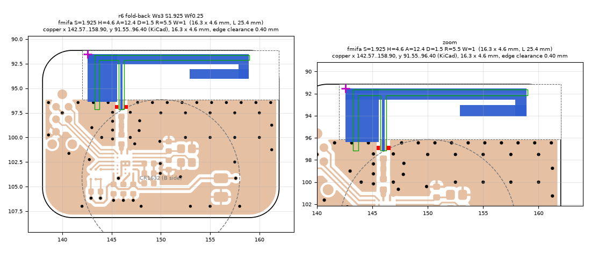
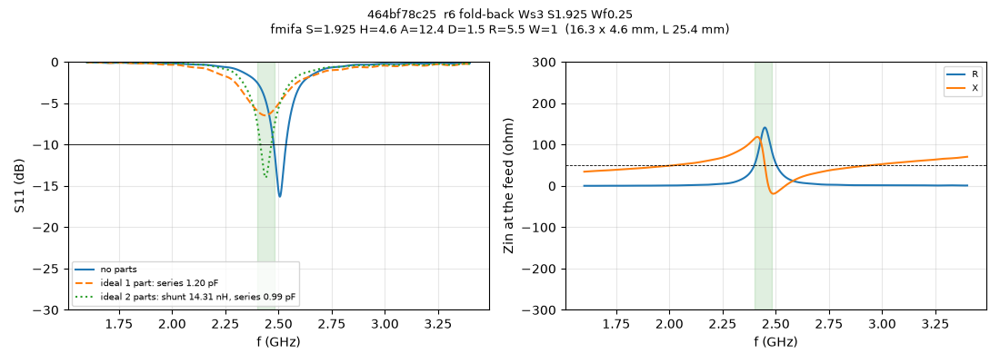

# 464bf78c25  r6 fold-back Ws3 S1.925 Wf0.25

**Purpose:** Matching parts allowed: lower antenna Q wanted. r6 base 1d83d77615 (Ws2 S1.425, Q 30-33, best T 6.2/0.8/6.8: worst channel -1.16 dB). Short leg 3 mm wide (gap to the feed leg kept at 0.3 mm).

## Antenna

`fmifa S=1.925 H=4.6 A=12.4 D=1.5 R=5.5 W=1  (16.3 x 4.6 mm, L 25.4 mm)`

| parameter | value |
|---|---|
| W | 1 |
| Wf | 0.25 |
| Ws | 3 |
| S | 1.925 |
| H | 4.6 |
| A | 12.4 |
| D | 1.5 |
| R | 5.5 |
| Nd | 1 |
| Nw | 0 |
| K | 1 |
| site | {"x": -4.0, "y": 3.55, "rot": 0, "mirror": false} |

Copper 16.32 x 4.60 mm above the ground edge (75.1 mm2), centre-line length 25.4 mm.
KiCad position of the copper: x 142.57..158.90, y 91.55..96.40, edge clearance 0.40 mm.

## Impedance at the feed (port across the notch)

| | |
|---|---|
| S11 minimum | -16.3 dB at 2.507 GHz |
| Z at 2.44 GHz | 133.8 +82.2j ohm |
| -10 dB band | 2.478-2.535 GHz |
| worst BLE S11, no parts | -2.5 dB |
| worst BLE S11, best ideal 1 part | -5.6 dB (series 1.20 pF) |
| worst BLE S11, best ideal 2 parts | -7.4 dB (shunt 14.31 nH, series 0.99 pF) |

Ideal lossless parts right at the feed, listed from the antenna toward the chip (shunt first = shunt on the antenna side). Real parts on pads with a trace and Q 30-50 give less (BSN: -15.3 dB ideal became -10.9 dB).

## Efficiency (raw own far-field transform, about +-10 %)

| f (GHz) | radiation eff. | total eff. (no match) | Dmax (dBi) |
|---|---|---|---|
| 2.40 | 63 % | 28 % | 1.7 |
| 2.44 | 69 % | 45 % | 1.7 |
| 2.48 | 71 % | 65 % | 1.7 |

## Run

board `build/r6/board.json`, battery True, mask none, model m3, 1921866 cells, 2032 s.
