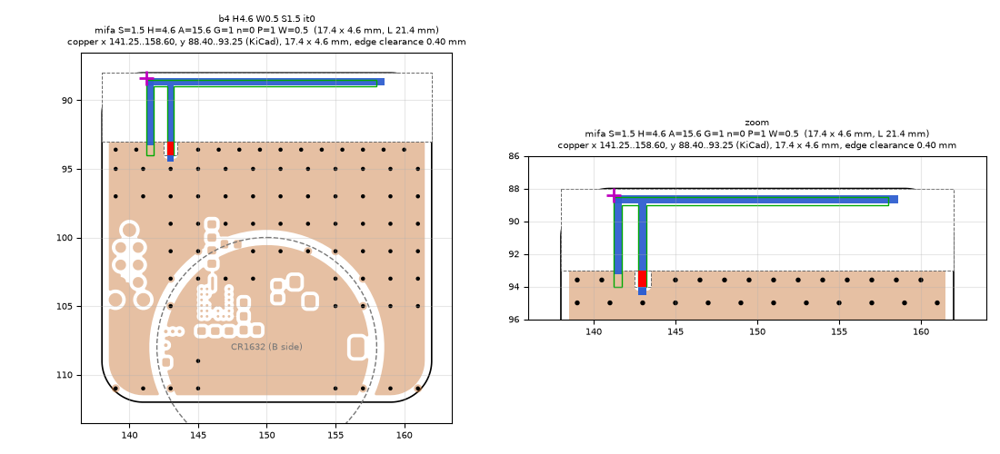
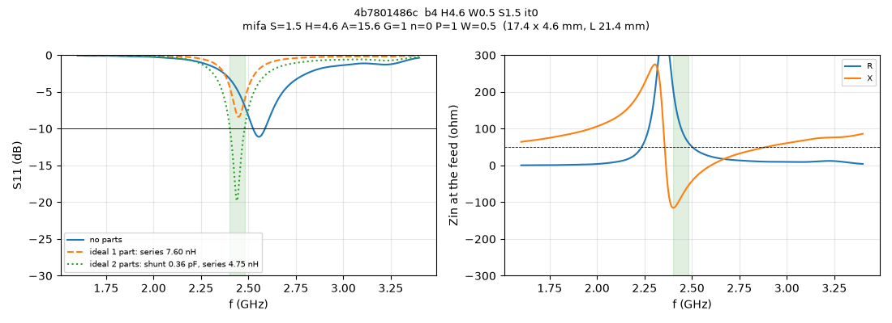

# 4b7801486c  b4 H4.6 W0.5 S1.5 it0

**Purpose:** Board copy b4 (feed at (143, 93), 24 x 5 keep-out, GND pours). b4 straight IFA (H4.5 W0.5 S1.0) it1 reached the target: S11 min -13.4 dB at 2.476 GHz but its -10 dB band is only 77 MHz (BLE needs 78), so the antenna Q is the limit. Variant: arm 4.6 mm high and S 1.5 (R at the minimum was 40 ohm, larger S raises it towards 50). Length tuned so the S11 minimum sits at 2.465 GHz.

## Antenna

`mifa S=1.5 H=4.6 A=15.6 G=1 n=0 P=1 W=0.5  (17.4 x 4.6 mm, L 21.4 mm)`

| parameter | value |
|---|---|
| W | 0.5 |
| Wf | 0.5 |
| Ws | 0.5 |
| S | 1.5 |
| H | 4.6 |
| A | 15.6 |
| G | 1 |
| n | 0 |
| P | 1 |
| Nd | 1 |
| Nw | 1 |
| K | 1 |
| site | {"x": -7.0, "y": 7.0, "rot": 0, "mirror": false} |

Copper 17.35 x 4.60 mm above the ground edge (79.8 mm2), centre-line length 21.4 mm.
KiCad position of the copper: x 141.25..158.60, y 88.40..93.25, edge clearance 0.40 mm.

## Impedance at the feed (port across the notch)

| | |
|---|---|
| S11 minimum | -11.1 dB at 2.556 GHz |
| Z at 2.44 GHz | 105.5 -89.0j ohm |
| -10 dB band | 2.525-2.587 GHz |
| worst BLE S11, no parts | -3.2 dB |
| worst BLE S11, best ideal 1 part | -4.2 dB (series 7.60 nH) |
| worst BLE S11, best ideal 2 parts | -9.5 dB (shunt 0.36 pF, series 4.75 nH) |

Ideal lossless parts right at the feed, listed from the antenna toward the chip (shunt first = shunt on the antenna side). Real parts on pads with a trace and Q 30-50 give less (BSN: -15.3 dB ideal became -10.9 dB).

## Efficiency (raw own far-field transform, about +-10 %)

| f (GHz) | radiation eff. | total eff. (no match) | Dmax (dBi) |
|---|---|---|---|
| 2.40 | 102 % | 53 % | 1.9 |
| 2.44 | 104 % | 68 % | 1.9 |
| 2.48 | 105 % | 83 % | 1.9 |

## Run

board `build/b4/board.json`, battery True, mask none, model m3, 2140450 cells, 4651 s.
