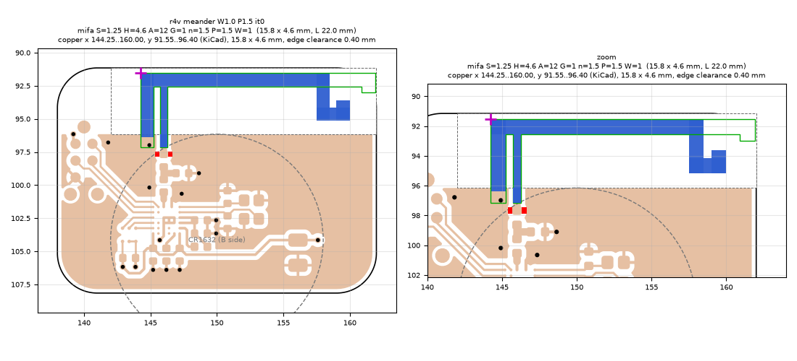
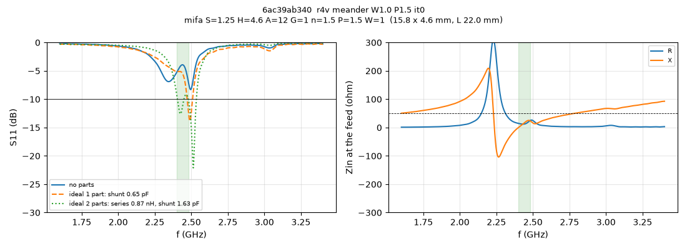

# 6ac39ab340  r4v meander W1.0 P1.5 it0

**Purpose:** Board r4v = r4 export plus 3 GND vias in the F.Cu pour island under the short leg (left of the feed trace), which is floating on the real r4 board (it0 there: 22 MHz band, 40 % efficiency). (AirTag.kicad_pcb of 2026-11-14 15:53: 24 x 17 mm, GND pours on both layers, AE1 at (146, 96.15), keep-out 20 x 5 mm (x 142..162) from the user-edited footprint, no notch, L1 right below the feed pad). Port beside the L1 feed pad (end of the matching network), so the result is what the network sees with no extra parts. S11 minimum tuned to 2.460 GHz. Variant: meander end, 1 mm traces, pitch 1.5 mm, fingers 1 mm above the ground, n tuned.

## Antenna

`mifa S=1.25 H=4.6 A=12 G=1 n=1.5 P=1.5 W=1  (15.8 x 4.6 mm, L 22.0 mm)`

| parameter | value |
|---|---|
| W | 1 |
| Wf | 0.5 |
| Ws | 1 |
| S | 1.25 |
| H | 4.6 |
| A | 12 |
| G | 1 |
| n | 1.5 |
| P | 1.5 |
| Nd | 1 |
| Nw | 1 |
| K | 1 |
| site | {"x": -4.0, "y": 3.55, "rot": 0, "mirror": false} |

Copper 15.75 x 4.60 mm above the ground edge (72.5 mm2), centre-line length 22.0 mm.
KiCad position of the copper: x 144.25..160.00, y 91.55..96.40, edge clearance 0.40 mm.

## Impedance at the feed (port across the notch)

| | |
|---|---|
| S11 minimum | -8.3 dB at 2.495 GHz |
| Z at 2.44 GHz | 12.3 +16.1j ohm |
| -10 dB band | - |
| worst BLE S11, no parts | -3.9 dB |
| worst BLE S11, best ideal 1 part | -5.1 dB (shunt 0.65 pF) |
| worst BLE S11, best ideal 2 parts | -9.2 dB (series 0.87 nH, shunt 1.63 pF) |

Ideal lossless parts right at the feed, listed from the antenna toward the chip (shunt first = shunt on the antenna side). Real parts on pads with a trace and Q 30-50 give less (BSN: -15.3 dB ideal became -10.9 dB).

## Efficiency (raw own far-field transform, about +-10 %)

| f (GHz) | radiation eff. | total eff. (no match) | Dmax (dBi) |
|---|---|---|---|
| 2.40 | 54 % | 38 % | 2.4 |
| 2.44 | 47 % | 28 % | 3.0 |
| 2.48 | 40 % | 32 % | 2.9 |

## Run

board `build/r4v/board.json`, battery True, mask none, model m3, 2047890 cells, 4482 s.
