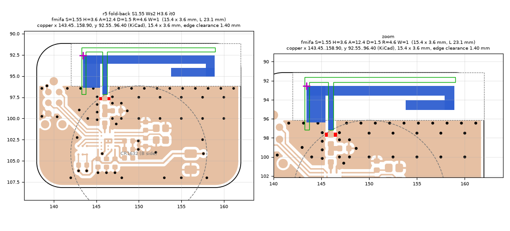
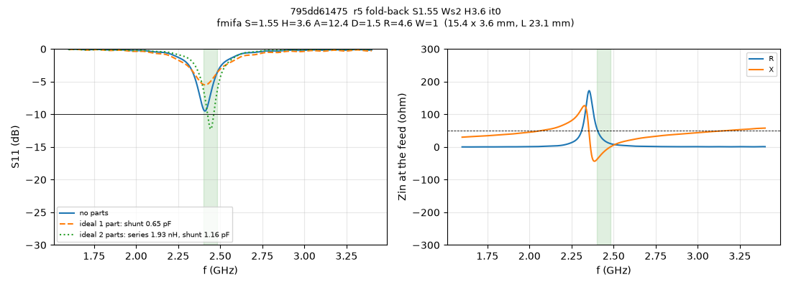

# 795dd61475  r5 fold-back S1.55 Ws2 H3.6 it0

**Purpose:** r5 S1.55 Ws2 (66fe09e3a9): Rmax still 215 ohm, match only on the upper flank (-10.7 dB, ~30 MHz). Lower arm (H 3.6 instead of 4.6) shrinks the feed-short loop: does Rmax come down towards 50-100 ohm? R tuned to 2.460 GHz.

## Antenna

`fmifa S=1.55 H=3.6 A=12.4 D=1.5 R=4.6 W=1  (15.4 x 3.6 mm, L 23.1 mm)`

| parameter | value |
|---|---|
| W | 1 |
| Wf | 0.5 |
| Ws | 2 |
| S | 1.55 |
| H | 3.6 |
| A | 12.4 |
| D | 1.5 |
| R | 4.6 |
| Nd | 1 |
| Nw | 0 |
| K | 1 |
| site | {"x": -4.0, "y": 3.55, "rot": 0, "mirror": false} |

Copper 15.45 x 3.60 mm above the ground edge (55.6 mm2), centre-line length 23.1 mm.
KiCad position of the copper: x 143.45..158.90, y 92.55..96.40, edge clearance 1.40 mm.

## Impedance at the feed (port across the notch)

| | |
|---|---|
| S11 minimum | -9.5 dB at 2.409 GHz |
| Z at 2.44 GHz | 21.9 -15.7j ohm |
| -10 dB band | - |
| worst BLE S11, no parts | -3.5 dB |
| worst BLE S11, best ideal 1 part | -3.6 dB (shunt 0.65 pF) |
| worst BLE S11, best ideal 2 parts | -6.2 dB (series 1.93 nH, shunt 1.16 pF) |

Ideal lossless parts right at the feed, listed from the antenna toward the chip (shunt first = shunt on the antenna side). Real parts on pads with a trace and Q 30-50 give less (BSN: -15.3 dB ideal became -10.9 dB).

## Efficiency (raw own far-field transform, about +-10 %)

| f (GHz) | radiation eff. | total eff. (no match) | Dmax (dBi) |
|---|---|---|---|
| 2.40 | 55 % | 48 % | 1.6 |
| 2.44 | 59 % | 47 % | 1.6 |
| 2.48 | 65 % | 37 % | 1.7 |

## Run

board `build/r5/board.json`, battery True, mask none, model m3, 2004992 cells, 1160 s.
