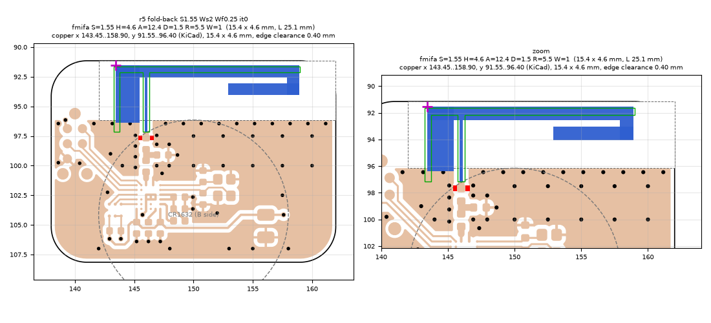
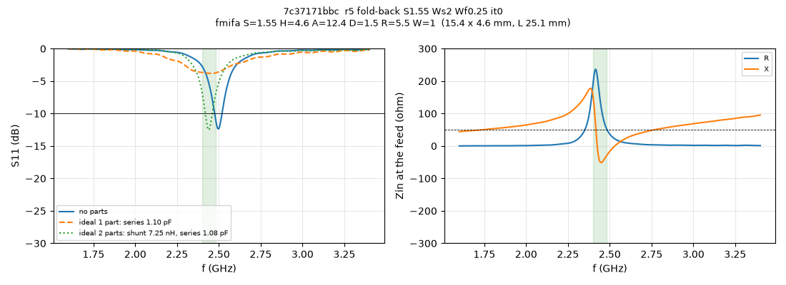

# 7c37171bbc  r5 fold-back S1.55 Ws2 Wf0.25 it0

**Purpose:** r5 S1.55 Ws2: the best match point always has R 40-45 ohm but X -25..-33 ohm (66fe09e3a9, db292e086d, H3.6 774412ed29), and the 1 mm feed leg made it worse. Narrow feed leg (0.25 mm, pad stays 0.5 mm) adds series inductance in the antenna: does the match deepen and widen with no parts? R tuned to 2.460 GHz.

## Antenna

`fmifa S=1.55 H=4.6 A=12.4 D=1.5 R=5.5 W=1  (15.4 x 4.6 mm, L 25.1 mm)`

| parameter | value |
|---|---|
| W | 1 |
| Wf | 0.25 |
| Ws | 2 |
| S | 1.55 |
| H | 4.6 |
| A | 12.4 |
| D | 1.5 |
| R | 5.5 |
| Nd | 1 |
| Nw | 0 |
| K | 1 |
| site | {"x": -4.0, "y": 3.55, "rot": 0, "mirror": false} |

Copper 15.45 x 4.60 mm above the ground edge (71.1 mm2), centre-line length 25.1 mm.
KiCad position of the copper: x 143.45..158.90, y 91.55..96.40, edge clearance 0.40 mm.

## Impedance at the feed (port across the notch)

| | |
|---|---|
| S11 minimum | -12.4 dB at 2.497 GHz |
| Z at 2.44 GHz | 152.2 -46.7j ohm |
| -10 dB band | 2.475-2.518 GHz |
| worst BLE S11, no parts | -2.7 dB |
| worst BLE S11, best ideal 1 part | -3.7 dB (series 1.10 pF) |
| worst BLE S11, best ideal 2 parts | -6.8 dB (shunt 7.25 nH, series 1.08 pF) |

Ideal lossless parts right at the feed, listed from the antenna toward the chip (shunt first = shunt on the antenna side). Real parts on pads with a trace and Q 30-50 give less (BSN: -15.3 dB ideal became -10.9 dB).

## Efficiency (raw own far-field transform, about +-10 %)

| f (GHz) | radiation eff. | total eff. (no match) | Dmax (dBi) |
|---|---|---|---|
| 2.40 | 72 % | 34 % | 1.6 |
| 2.44 | 75 % | 53 % | 1.6 |
| 2.48 | 75 % | 69 % | 1.7 |

## Run

board `build/r5/board.json`, battery True, mask none, model m3, 2004992 cells, 2141 s.
