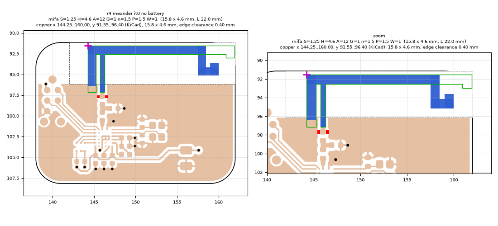
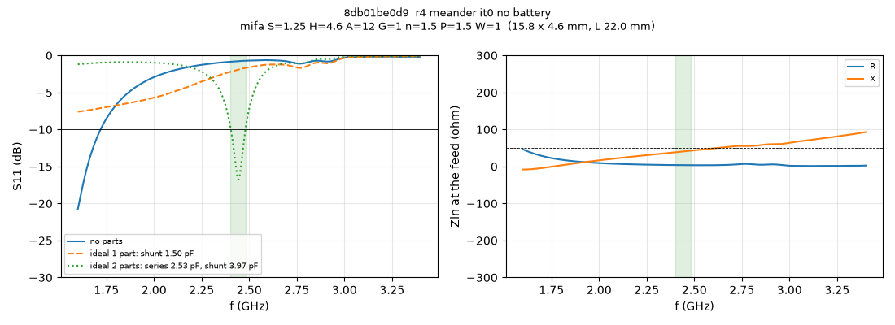

# 8db01be0d9  r4 meander it0 no battery

**Purpose:** Diagnostic of r4 meander it0 (c2d53a710f: -10 dB band only 22 MHz, radiation efficiency 40 %, ring-down 112k steps). Without the CR1632 and holder: on r4 the cell edge reaches the antenna ground edge right under the feed. Does the bandwidth / efficiency recover?

## Antenna

`mifa S=1.25 H=4.6 A=12 G=1 n=1.5 P=1.5 W=1  (15.8 x 4.6 mm, L 22.0 mm)`

| parameter | value |
|---|---|
| W | 1 |
| Wf | 0.5 |
| Ws | 1 |
| S | 1.25 |
| H | 4.6 |
| A | 12 |
| G | 1 |
| n | 1.5 |
| P | 1.5 |
| Nd | 1 |
| Nw | 1 |
| K | 1 |
| site | {"x": -4.0, "y": 3.55, "rot": 0, "mirror": false} |

Copper 15.75 x 4.60 mm above the ground edge (72.5 mm2), centre-line length 22.0 mm.
KiCad position of the copper: x 144.25..160.00, y 91.55..96.40, edge clearance 0.40 mm.

## Impedance at the feed (port across the notch)

| | |
|---|---|
| S11 minimum | -20.8 dB at 1.600 GHz |
| Z at 2.44 GHz | 3.6 +40.4j ohm |
| -10 dB band | 1.600-1.719 GHz |
| worst BLE S11, no parts | -0.7 dB |
| worst BLE S11, best ideal 1 part | -1.7 dB (shunt 1.50 pF) |
| worst BLE S11, best ideal 2 parts | -9.5 dB (series 2.53 pF, shunt 3.97 pF) |

Ideal lossless parts right at the feed, listed from the antenna toward the chip (shunt first = shunt on the antenna side). Real parts on pads with a trace and Q 30-50 give less (BSN: -15.3 dB ideal became -10.9 dB).

## Efficiency (raw own far-field transform, about +-10 %)

| f (GHz) | radiation eff. | total eff. (no match) | Dmax (dBi) |
|---|---|---|---|
| 2.40 | 7 % | 1 % | 1.1 |
| 2.44 | 8 % | 1 % | 1.1 |
| 2.48 | 8 % | 1 % | 1.2 |

## Run

board `build/r4/board.json`, battery False, mask none, model m3, 1786575 cells, 2331 s.
