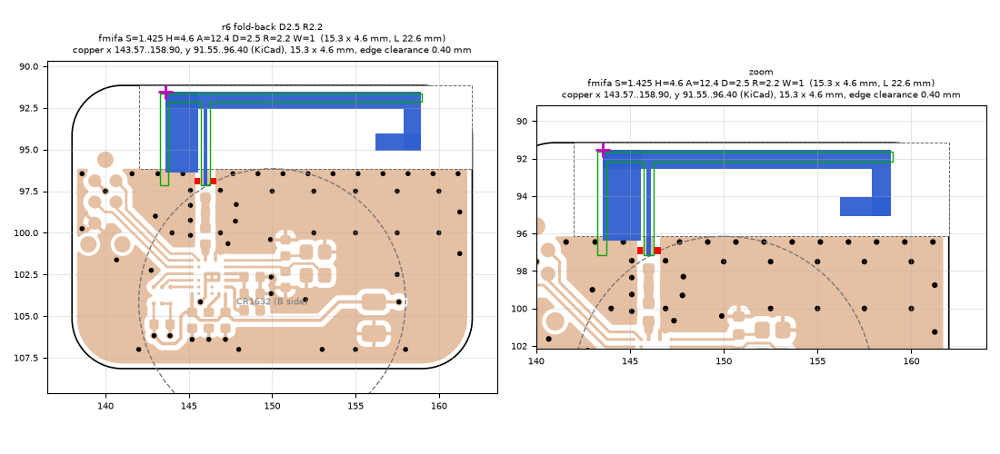
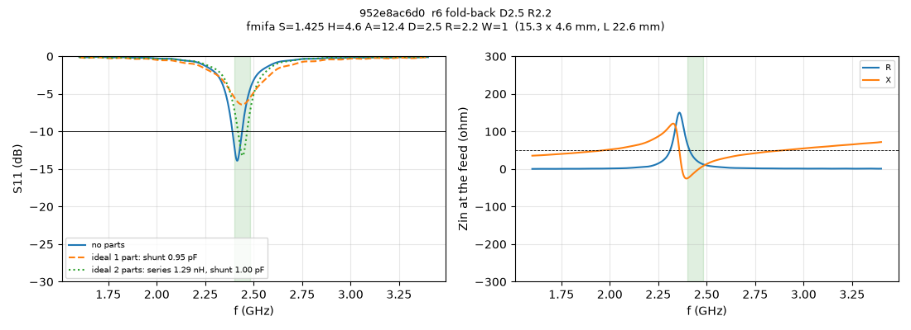

# 952e8ac6d0  r6 fold-back D2.5 R2.2

**Purpose:** Matching parts allowed, lowest antenna Q wanted. df2a380b0b resonated at 2.13 GHz (Q 29 there): return row shortened so the resonance lands near 2.44 GHz, then compare Q and the match_tee result with the base 1d83d77615 (Q 30-33, -1.16 dB worst channel).

## Antenna

`fmifa S=1.425 H=4.6 A=12.4 D=2.5 R=2.2 W=1  (15.3 x 4.6 mm, L 22.6 mm)`

| parameter | value |
|---|---|
| W | 1 |
| Wf | 0.25 |
| Ws | 2 |
| S | 1.425 |
| H | 4.6 |
| A | 12.4 |
| D | 2.5 |
| R | 2.2 |
| Nd | 1 |
| Nw | 0 |
| K | 1 |
| site | {"x": -4.0, "y": 3.55, "rot": 0, "mirror": false} |

Copper 15.32 x 4.60 mm above the ground edge (70.5 mm2), centre-line length 22.6 mm.
KiCad position of the copper: x 143.57..158.90, y 91.55..96.40, edge clearance 0.40 mm.

## Impedance at the feed (port across the notch)

| | |
|---|---|
| S11 minimum | -13.9 dB at 2.415 GHz |
| Z at 2.44 GHz | 26.7 -7.7j ohm |
| -10 dB band | 2.391-2.439 GHz |
| worst BLE S11, no parts | -4.2 dB |
| worst BLE S11, best ideal 1 part | -5.4 dB (shunt 0.95 pF) |
| worst BLE S11, best ideal 2 parts | -7.1 dB (series 1.29 nH, shunt 1.00 pF) |

Ideal lossless parts right at the feed, listed from the antenna toward the chip (shunt first = shunt on the antenna side). Real parts on pads with a trace and Q 30-50 give less (BSN: -15.3 dB ideal became -10.9 dB).

## Efficiency (raw own far-field transform, about +-10 %)

| f (GHz) | radiation eff. | total eff. (no match) | Dmax (dBi) |
|---|---|---|---|
| 2.40 | 64 % | 60 % | 1.7 |
| 2.44 | 68 % | 61 % | 1.7 |
| 2.48 | 75 % | 48 % | 1.7 |

## Run

board `build/r6/board.json`, battery True, mask none, model m3, 1921866 cells, 2471 s.
