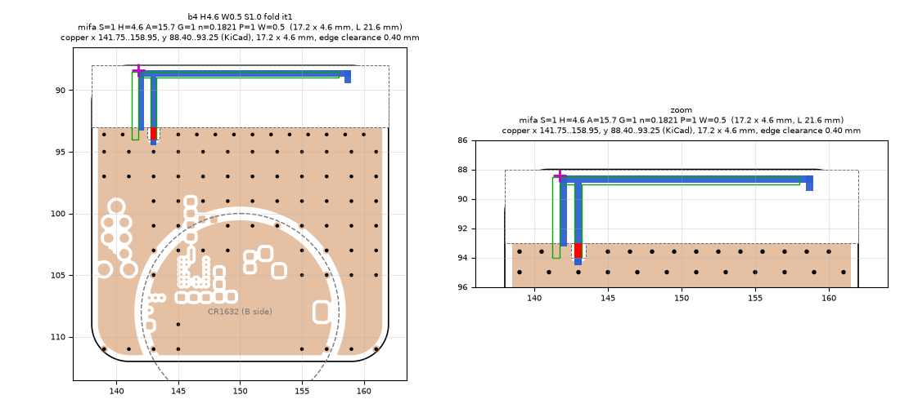
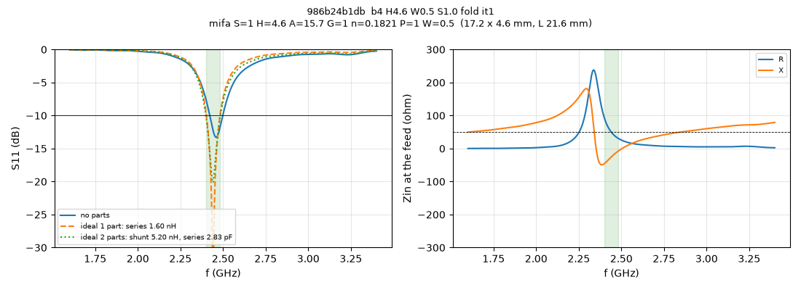

# 986b24b1db  b4 H4.6 W0.5 S1.0 fold it1

**Purpose:** Board copy b4 (feed at (143, 93), 24 x 5 keep-out, GND pours). b4 straight IFA (H4.5 W0.5 S1.0) it1 reached the target: S11 min -13.4 dB at 2.476 GHz but its -10 dB band is only 77 MHz (BLE needs 78), so the antenna Q is the limit. Variant: arm raised to the board edge limit (4.6 mm, 0.4 mm edge clearance) for more bandwidth. The corner limits a straight arm to A 15.95 at this height, so a short fold down at the end (n) is tuned so the S11 minimum sits at 2.465 GHz.

## Antenna

`mifa S=1 H=4.6 A=15.7 G=1 n=0.1821 P=1 W=0.5  (17.2 x 4.6 mm, L 21.6 mm)`

| parameter | value |
|---|---|
| W | 0.5 |
| Wf | 0.5 |
| Ws | 0.5 |
| S | 1 |
| H | 4.6 |
| A | 15.7 |
| G | 1 |
| n | 0.1821 |
| P | 1 |
| Nd | 1 |
| Nw | 1 |
| K | 1 |
| site | {"x": -7.0, "y": 7.0, "rot": 0, "mirror": false} |

Copper 17.20 x 4.60 mm above the ground edge (79.1 mm2), centre-line length 21.6 mm.
KiCad position of the copper: x 141.75..158.95, y 88.40..93.25, edge clearance 0.40 mm.

## Impedance at the feed (port across the notch)

| | |
|---|---|
| S11 minimum | -13.3 dB at 2.459 GHz |
| Z at 2.44 GHz | 50.3 -25.7j ohm |
| -10 dB band | 2.423-2.498 GHz |
| worst BLE S11, no parts | -7.6 dB |
| worst BLE S11, best ideal 1 part | -9.5 dB (series 1.60 nH) |
| worst BLE S11, best ideal 2 parts | -10.2 dB (shunt 5.20 nH, series 2.83 pF) |

Ideal lossless parts right at the feed, listed from the antenna toward the chip (shunt first = shunt on the antenna side). Real parts on pads with a trace and Q 30-50 give less (BSN: -15.3 dB ideal became -10.9 dB).

## Efficiency (raw own far-field transform, about +-10 %)

| f (GHz) | radiation eff. | total eff. (no match) | Dmax (dBi) |
|---|---|---|---|
| 2.40 | 101 % | 83 % | 1.8 |
| 2.44 | 102 % | 96 % | 1.9 |
| 2.48 | 104 % | 98 % | 1.9 |

## Run

board `build/b4/board.json`, battery True, mask none, model m3, 2163590 cells, 4792 s.
