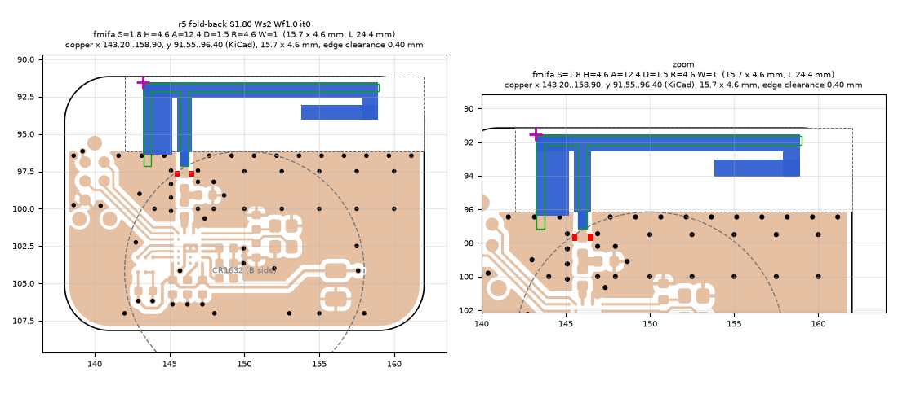
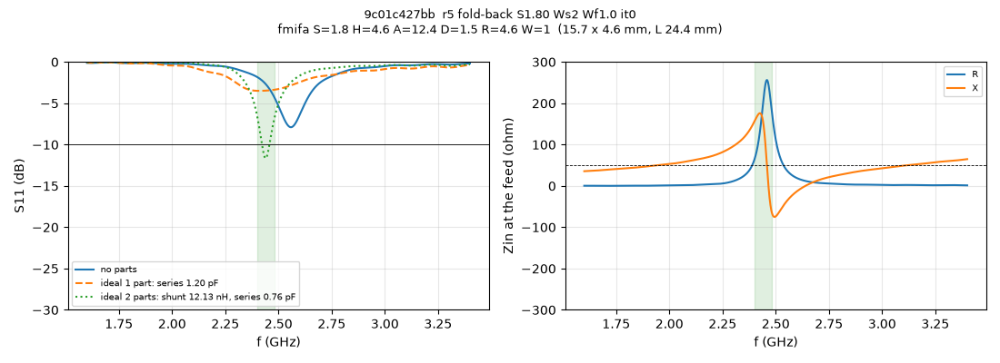

# 9c01c427bb  r5 fold-back S1.80 Ws2 Wf1.0 it0

**Purpose:** r5 S1.55 Ws2.0 (00308fa64b): Rmax 219 ohm, best match -11.2 dB at 2.639 GHz (Z 39-23j) above the resonance. Lengthen the return row R so this match point moves to 2.460 GHz. Feed leg 1 mm wide (pad stays 0.5 mm, short moved to keep the 0.3 mm gap): less series inductance (Z2440 had +120j)?

## Antenna

`fmifa S=1.8 H=4.6 A=12.4 D=1.5 R=4.6 W=1  (15.7 x 4.6 mm, L 24.4 mm)`

| parameter | value |
|---|---|
| W | 1 |
| Wf | 1 |
| Ws | 2 |
| S | 1.8 |
| H | 4.6 |
| A | 12.4 |
| D | 1.5 |
| R | 4.6 |
| Nd | 1 |
| Nw | 0 |
| K | 1 |
| site | {"x": -4.0, "y": 3.55, "rot": 0, "mirror": false} |

Copper 15.70 x 4.60 mm above the ground edge (72.2 mm2), centre-line length 24.4 mm.
KiCad position of the copper: x 143.20..158.90, y 91.55..96.40, edge clearance 0.40 mm.

## Impedance at the feed (port across the notch)

| | |
|---|---|
| S11 minimum | -7.9 dB at 2.559 GHz |
| Z at 2.44 GHz | 197.7 +157.1j ohm |
| -10 dB band | - |
| worst BLE S11, no parts | -1.8 dB |
| worst BLE S11, best ideal 1 part | -3.4 dB (series 1.20 pF) |
| worst BLE S11, best ideal 2 parts | -6.6 dB (shunt 12.13 nH, series 0.76 pF) |

Ideal lossless parts right at the feed, listed from the antenna toward the chip (shunt first = shunt on the antenna side). Real parts on pads with a trace and Q 30-50 give less (BSN: -15.3 dB ideal became -10.9 dB).

## Efficiency (raw own far-field transform, about +-10 %)

| f (GHz) | radiation eff. | total eff. (no match) | Dmax (dBi) |
|---|---|---|---|
| 2.40 | 70 % | 24 % | 1.6 |
| 2.44 | 75 % | 35 % | 1.6 |
| 2.48 | 77 % | 48 % | 1.6 |

## Run

board `build/r5/board.json`, battery True, mask none, model m3, 2004992 cells, 1922 s.
