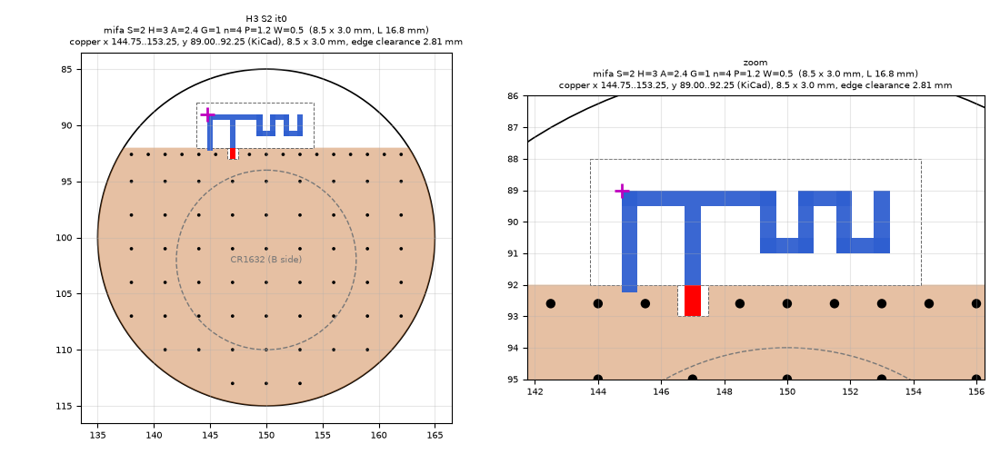
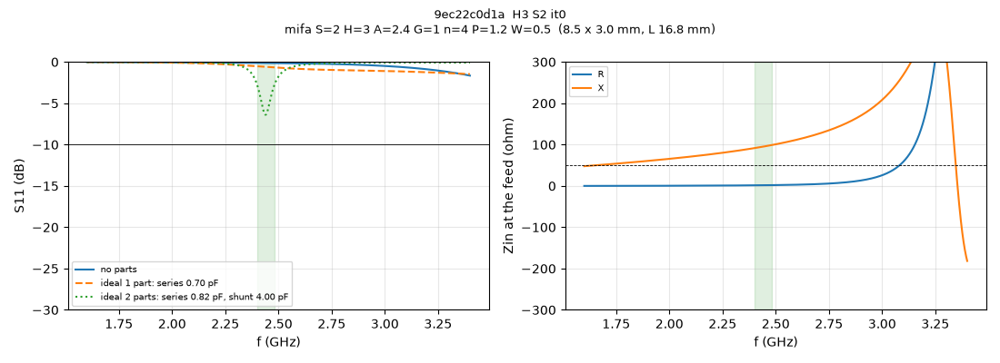

# 9ec22c0d1a  H3 S2 it0

**Purpose:** First exploration on a synthetic 30 mm disc board (2 layers 1.0 mm, CR1632 under the board, 7 mm clearance): how arm height H and feed-short spacing S set the peak feed resistance and the matched bandwidth once the meander length n is tuned to 2.465 GHz.

## Antenna

`mifa S=2 H=3 A=2.4 G=1 n=4 P=1.2 W=0.5  (8.5 x 3.0 mm, L 16.8 mm)`

| parameter | value |
|---|---|
| W | 0.5 |
| Wf | 0.5 |
| Ws | 0.5 |
| S | 2 |
| H | 3 |
| A | 2.4 |
| G | 1 |
| n | 4 |
| P | 1.2 |
| Nd | 1 |
| Nw | 1 |
| K | 1 |
| site | {"x": -3.0, "y": 8.0, "rot": 0, "mirror": false} |

Copper 8.50 x 3.00 mm above the ground edge (25.5 mm2), centre-line length 16.8 mm.
KiCad position of the copper: x 144.75..153.25, y 89.00..92.25, edge clearance 2.81 mm.

## Impedance at the feed (port across the notch)

| | |
|---|---|
| S11 minimum | -1.6 dB at 3.400 GHz |
| Z at 2.44 GHz | 1.7 +95.1j ohm |
| -10 dB band | - |
| worst BLE S11, no parts | -0.1 dB |
| worst BLE S11, best ideal 1 part | -0.5 dB (series 0.70 pF) |
| worst BLE S11, best ideal 2 parts | -2.6 dB (series 0.82 pF, shunt 4.00 pF) |

Ideal lossless parts right at the feed, listed from the antenna toward the chip (shunt first = shunt on the antenna side). Real parts on pads with a trace and Q 30-50 give less (BSN: -15.3 dB ideal became -10.9 dB).

## Efficiency (raw own far-field transform, about +-10 %)

| f (GHz) | radiation eff. | total eff. (no match) | Dmax (dBi) |
|---|---|---|---|
| 2.40 | 61 % | 2 % | 1.7 |
| 2.44 | 64 % | 2 % | 1.7 |
| 2.48 | 68 % | 2 % | 1.7 |

## Run

board `build/disc30c7/board.json`, battery True, mask none, model m2, 1565544 cells, 1278 s.
