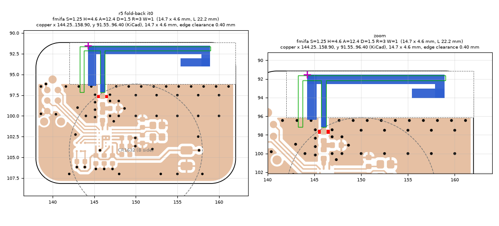
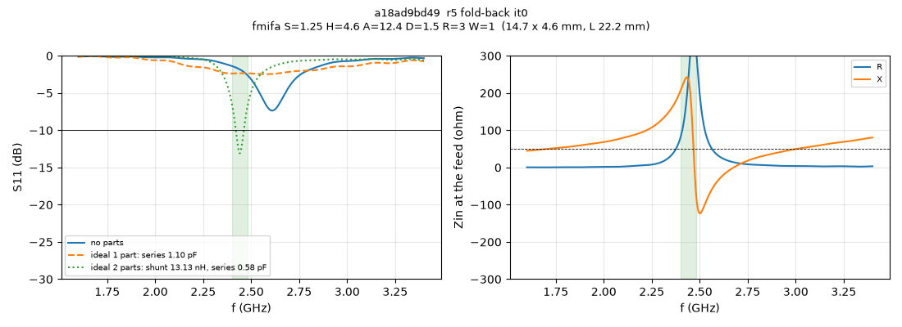

# a18ad9bd49  r5 fold-back it0

**Purpose:** Board r5 = AirTag.kicad_pcb of 2026-11-14 19:20 with the GND via stitching added by the user (57 vias, short-leg island stitched). Fold-back it0 geometry (W1 S1.25 H4.6 A12.4 D1.5 R3), compare with r4 (floating island) and r4v (3 test vias, double resonance 2.39/2.515 GHz).

## Antenna

`fmifa S=1.25 H=4.6 A=12.4 D=1.5 R=3 W=1  (14.7 x 4.6 mm, L 22.2 mm)`

| parameter | value |
|---|---|
| W | 1 |
| Wf | 0.5 |
| Ws | 1 |
| S | 1.25 |
| H | 4.6 |
| A | 12.4 |
| D | 1.5 |
| R | 3 |
| Nd | 1 |
| Nw | 1 |
| K | 1 |
| site | {"x": -4.0, "y": 3.55, "rot": 0, "mirror": false} |

Copper 14.65 x 4.60 mm above the ground edge (67.4 mm2), centre-line length 22.2 mm.
KiCad position of the copper: x 144.25..158.90, y 91.55..96.40, edge clearance 0.40 mm.

## Impedance at the feed (port across the notch)

| | |
|---|---|
| S11 minimum | -7.4 dB at 2.610 GHz |
| Z at 2.44 GHz | 232.4 +237.7j ohm |
| -10 dB band | - |
| worst BLE S11, no parts | -1.4 dB |
| worst BLE S11, best ideal 1 part | -2.3 dB (series 1.10 pF) |
| worst BLE S11, best ideal 2 parts | -6.5 dB (shunt 13.13 nH, series 0.58 pF) |

Ideal lossless parts right at the feed, listed from the antenna toward the chip (shunt first = shunt on the antenna side). Real parts on pads with a trace and Q 30-50 give less (BSN: -15.3 dB ideal became -10.9 dB).

## Efficiency (raw own far-field transform, about +-10 %)

| f (GHz) | radiation eff. | total eff. (no match) | Dmax (dBi) |
|---|---|---|---|
| 2.40 | 67 % | 18 % | 1.6 |
| 2.44 | 74 % | 25 % | 1.6 |
| 2.48 | 79 % | 35 % | 1.6 |

## Run

board `build/r5/board.json`, battery True, mask none, model m3, 2016384 cells, 1935 s.
