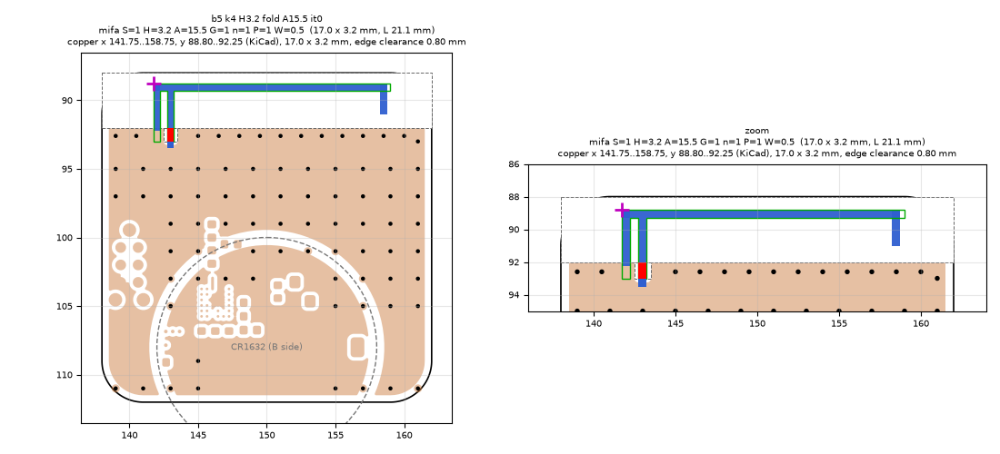
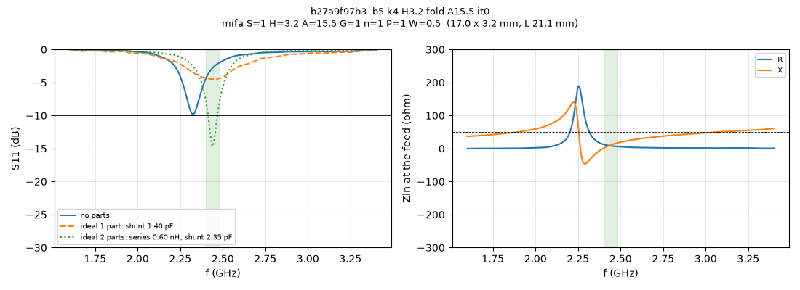

# b27a9f97b3  b5 k4 H3.2 fold A15.5 it0

**Purpose:** Keep-out height experiment, feed at (143, 92) like b4, the keep-out top stays at the board edge (KiCad y 88). Board copy b5 (sim/boards/b5: AirTag.kicad_pcb of 2026-11-14 01:21 with GND pours and a via fence, AE1 = MIFA_f143k4: 24 x 4 mm keep-out). b4 (24 x 5) straight IFA it0 gave S11 -14.4 dB at 2.551 GHz with Z 40-14j at the minimum and a 90 MHz -10 dB band. Does a 4 mm (lower) keep-out widen (or narrow) the matched band? S at its minimum, length tuned so the S11 minimum sits at 2.465 GHz. Variant: IFA with a fold down at the end (in case the straight arm runs out of length).

## Antenna

`mifa S=1 H=3.2 A=15.5 G=1 n=1 P=1 W=0.5  (17.0 x 3.2 mm, L 21.1 mm)`

| parameter | value |
|---|---|
| W | 0.5 |
| Wf | 0.5 |
| Ws | 0.5 |
| S | 1 |
| H | 3.2 |
| A | 15.5 |
| G | 1 |
| n | 1 |
| P | 1 |
| Nd | 1 |
| Nw | 1 |
| K | 1 |
| site | {"x": -7.0, "y": 8.0, "rot": 0, "mirror": false} |

Copper 17.00 x 3.20 mm above the ground edge (54.4 mm2), centre-line length 21.1 mm.
KiCad position of the copper: x 141.75..158.75, y 88.80..92.25, edge clearance 0.80 mm.

## Impedance at the feed (port across the notch)

| | |
|---|---|
| S11 minimum | -9.8 dB at 2.325 GHz |
| Z at 2.44 GHz | 8.3 +10.6j ohm |
| -10 dB band | - |
| worst BLE S11, no parts | -1.9 dB |
| worst BLE S11, best ideal 1 part | -4.3 dB (shunt 1.40 pF) |
| worst BLE S11, best ideal 2 parts | -7.6 dB (series 0.60 nH, shunt 2.35 pF) |

Ideal lossless parts right at the feed, listed from the antenna toward the chip (shunt first = shunt on the antenna side). Real parts on pads with a trace and Q 30-50 give less (BSN: -15.3 dB ideal became -10.9 dB).

## Efficiency (raw own far-field transform, about +-10 %)

| f (GHz) | radiation eff. | total eff. (no match) | Dmax (dBi) |
|---|---|---|---|
| 2.40 | 87 % | 55 % | 1.9 |
| 2.44 | 88 % | 42 % | 1.9 |
| 2.48 | 86 % | 32 % | 1.9 |

## Run

board `build/b5/board.json`, battery True, mask none, model m3, 2113661 cells, 8542 s.
