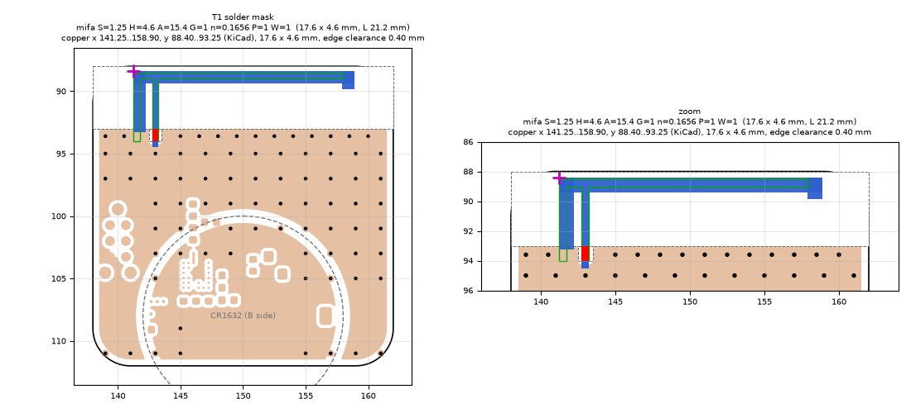
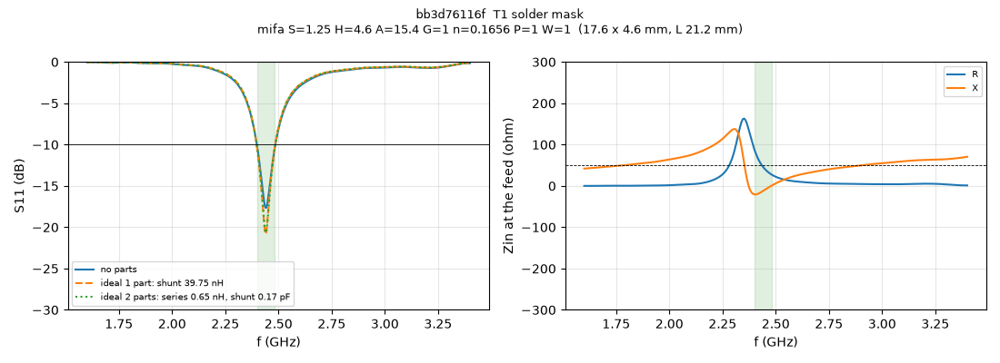

# bb3d76116f  T1 solder mask

**Purpose:** Robustness of the chosen design MIFA_2G4_T1 (run a21ed6f324: b4, feed (143, 93), 5 mm keep-out, H4.6 W1.0 S1.25 A15.4 n0.17, S11 min -18.5 dB at 2.459 GHz, -10 dB band 88 MHz). explicit 20 um solder mask (er 3.8) on both sides, checks the assumed -1 % shift that the 2.465 GHz target is based on. Slow (fine z cells).

## Antenna

`mifa S=1.25 H=4.6 A=15.4 G=1 n=0.1656 P=1 W=1  (17.6 x 4.6 mm, L 21.2 mm)`

| parameter | value |
|---|---|
| W | 1 |
| Wf | 0.5 |
| Ws | 1 |
| S | 1.25 |
| H | 4.6 |
| A | 15.4 |
| G | 1 |
| n | 0.1656 |
| P | 1 |
| Nd | 1 |
| Nw | 1 |
| K | 1 |
| site | {"x": -7.0, "y": 7.0, "rot": 0, "mirror": false} |

Copper 17.65 x 4.60 mm above the ground edge (81.2 mm2), centre-line length 21.2 mm.
KiCad position of the copper: x 141.25..158.90, y 88.40..93.25, edge clearance 0.40 mm.

## Impedance at the feed (port across the notch)

| | |
|---|---|
| S11 minimum | -17.7 dB at 2.441 GHz |
| Z at 2.44 GHz | 46.3 -12.2j ohm |
| -10 dB band | 2.399-2.485 GHz |
| worst BLE S11, no parts | -10.2 dB |
| worst BLE S11, best ideal 1 part | -10.2 dB (shunt 39.75 nH) |
| worst BLE S11, best ideal 2 parts | -10.4 dB (series 0.65 nH, shunt 0.17 pF) |

Ideal lossless parts right at the feed, listed from the antenna toward the chip (shunt first = shunt on the antenna side). Real parts on pads with a trace and Q 30-50 give less (BSN: -15.3 dB ideal became -10.9 dB).

## Efficiency (raw own far-field transform, about +-10 %)

| f (GHz) | radiation eff. | total eff. (no match) | Dmax (dBi) |
|---|---|---|---|
| 2.40 | 95 % | 86 % | 1.9 |
| 2.44 | 96 % | 94 % | 1.9 |
| 2.48 | 99 % | 91 % | 1.9 |

## Run

board `build/b4/board.json`, battery True, mask explicit, model m3, 3622190 cells, 8527 s.
