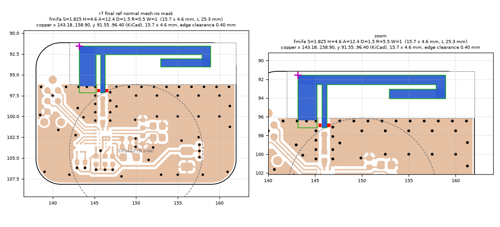
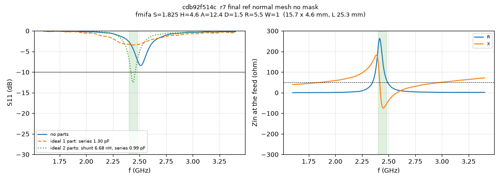

# cdb92f514c  r7 final ref normal mesh no mask

**Purpose:** Final check 2026-11-15 on the board as saved (r7). Same antenna as d2774450d4 (r6), normal mesh without solder mask: shows what changed from r6 to r7 and is the low-resolution reference.

## Antenna

`fmifa S=1.825 H=4.6 A=12.4 D=1.5 R=5.5 W=1  (15.7 x 4.6 mm, L 25.3 mm)`

| parameter | value |
|---|---|
| W | 1 |
| Wf | 0.5 |
| Ws | 2 |
| S | 1.825 |
| H | 4.6 |
| A | 12.4 |
| D | 1.5 |
| R | 5.5 |
| Nd | 1 |
| Nw | 0 |
| K | 1 |
| site | {"x": -4.0, "y": 3.55, "rot": 0, "mirror": false} |

Copper 15.72 x 4.60 mm above the ground edge (72.3 mm2), centre-line length 25.3 mm.
KiCad position of the copper: x 143.18..158.90, y 91.55..96.40, edge clearance 0.40 mm.

## Impedance at the feed (port across the notch)

| | |
|---|---|
| S11 minimum | -8.4 dB at 2.511 GHz |
| Z at 2.44 GHz | 173.3 -68.4j ohm |
| -10 dB band | - |
| worst BLE S11, no parts | -2.6 dB |
| worst BLE S11, best ideal 1 part | -3.3 dB (series 1.30 pF) |
| worst BLE S11, best ideal 2 parts | -6.7 dB (shunt 6.68 nH, series 0.99 pF) |

Ideal lossless parts right at the feed, listed from the antenna toward the chip (shunt first = shunt on the antenna side). Real parts on pads with a trace and Q 30-50 give less (BSN: -15.3 dB ideal became -10.9 dB).

## Efficiency (raw own far-field transform, about +-10 %)

| f (GHz) | radiation eff. | total eff. (no match) | Dmax (dBi) |
|---|---|---|---|
| 2.40 | 73 % | 33 % | 1.7 |
| 2.44 | 75 % | 47 % | 1.7 |
| 2.48 | 75 % | 61 % | 1.7 |

## Run

board `build/r7/board.json`, battery True, mask none, model m3, 1911008 cells, 3040 s.
