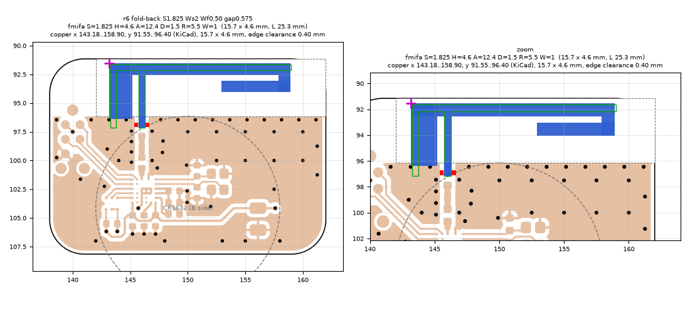
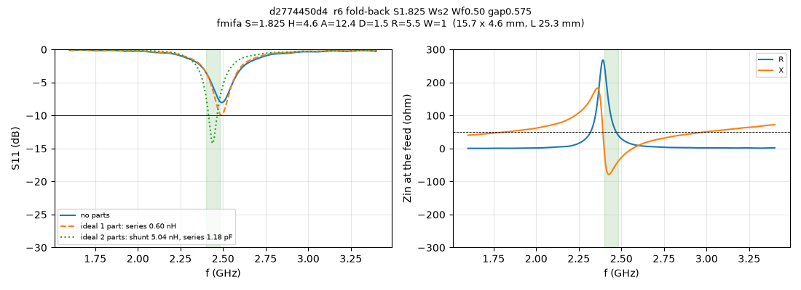

# d2774450d4  r6 fold-back S1.825 Ws2 Wf0.50 gap0.575

**Purpose:** User rule 2026-11-15: short-to-feed gap at least 0.575 mm edge to edge (chosen design 1d83d77615 had 0.3 mm). Same fold-back with the gap opened to 0.575 mm, feed leg 0.50 mm. New L2-C1-L1 values from match_tee.py.

## Antenna

`fmifa S=1.825 H=4.6 A=12.4 D=1.5 R=5.5 W=1  (15.7 x 4.6 mm, L 25.3 mm)`

| parameter | value |
|---|---|
| W | 1 |
| Wf | 0.5 |
| Ws | 2 |
| S | 1.825 |
| H | 4.6 |
| A | 12.4 |
| D | 1.5 |
| R | 5.5 |
| Nd | 1 |
| Nw | 0 |
| K | 1 |
| site | {"x": -4.0, "y": 3.55, "rot": 0, "mirror": false} |

Copper 15.72 x 4.60 mm above the ground edge (72.3 mm2), centre-line length 25.3 mm.
KiCad position of the copper: x 143.18..158.90, y 91.55..96.40, edge clearance 0.40 mm.

## Impedance at the feed (port across the notch)

| | |
|---|---|
| S11 minimum | -8.0 dB at 2.493 GHz |
| Z at 2.44 GHz | 95.8 -72.2j ohm |
| -10 dB band | - |
| worst BLE S11, no parts | -3.5 dB |
| worst BLE S11, best ideal 1 part | -3.5 dB (series 0.60 nH) |
| worst BLE S11, best ideal 2 parts | -7.2 dB (shunt 5.04 nH, series 1.18 pF) |

Ideal lossless parts right at the feed, listed from the antenna toward the chip (shunt first = shunt on the antenna side). Real parts on pads with a trace and Q 30-50 give less (BSN: -15.3 dB ideal became -10.9 dB).

## Efficiency (raw own far-field transform, about +-10 %)

| f (GHz) | radiation eff. | total eff. (no match) | Dmax (dBi) |
|---|---|---|---|
| 2.40 | 69 % | 38 % | 1.7 |
| 2.44 | 70 % | 51 % | 1.7 |
| 2.48 | 72 % | 60 % | 1.7 |

## Run

board `build/r6/board.json`, battery True, mask none, model m3, 1911008 cells, 1782 s.
