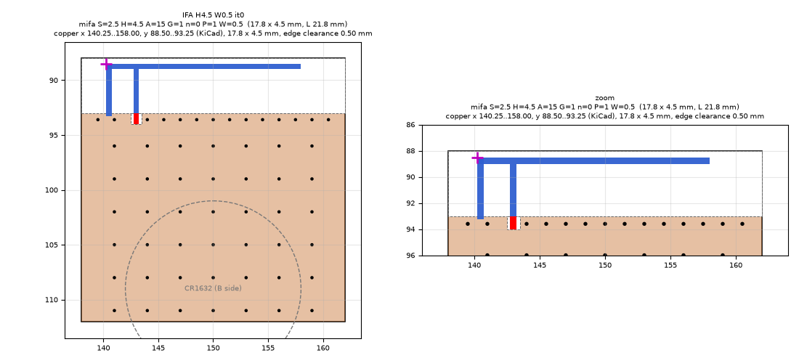
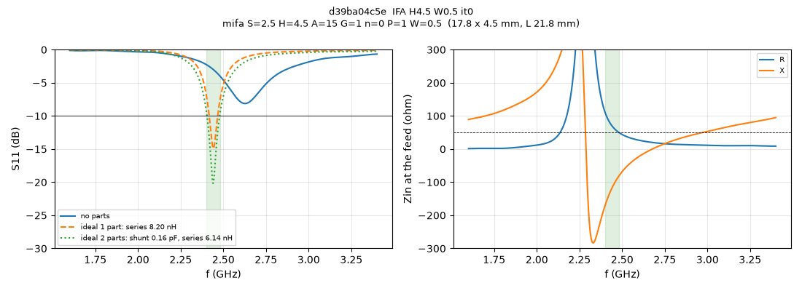

# d39ba04c5e  IFA H4.5 W0.5 it0

**Purpose:** Can the antenna reach 50 ohm without a matching network inside the 24 x 5 mm keep-out (full PCB width, user 2026-11-14)? Synthetic board matching AirTag.kicad_pcb as of 2026-11-14 (24 x 24 mm outline, 2 layers 1.6 mm, CR1632 on the back at BT1 (150, 109), overhanging the bottom edge as laid out, no pours yet so all ground below the keep-out), AE1 feed at (143, 93): keep-out = full width, top edge. Tuned: arm length to 2.465 GHz and S towards Rmax 50 ohm. Variant: straight IFA, the generic start.

## Antenna

`mifa S=2.5 H=4.5 A=15 G=1 n=0 P=1 W=0.5  (17.8 x 4.5 mm, L 21.8 mm)`

| parameter | value |
|---|---|
| W | 0.5 |
| Wf | 0.5 |
| Ws | 0.5 |
| S | 2.5 |
| H | 4.5 |
| A | 15 |
| G | 1 |
| n | 0 |
| P | 1 |
| Nd | 1 |
| Nw | 1 |
| K | 1 |
| site | {"x": -7.0, "y": 7.0, "rot": 0, "mirror": false} |

Copper 17.75 x 4.50 mm above the ground edge (79.9 mm2), centre-line length 21.8 mm.
KiCad position of the copper: x 140.25..158.00, y 88.50..93.25, edge clearance 0.50 mm.

## Impedance at the feed (port across the notch)

| | |
|---|---|
| S11 minimum | -8.1 dB at 2.627 GHz |
| Z at 2.44 GHz | 70.3 -118.0j ohm |
| -10 dB band | - |
| worst BLE S11, no parts | -2.2 dB |
| worst BLE S11, best ideal 1 part | -6.8 dB (series 8.20 nH) |
| worst BLE S11, best ideal 2 parts | -9.2 dB (shunt 0.16 pF, series 6.14 nH) |

Ideal lossless parts right at the feed, listed from the antenna toward the chip (shunt first = shunt on the antenna side). Real parts on pads with a trace and Q 30-50 give less (BSN: -15.3 dB ideal became -10.9 dB).

## Efficiency (raw own far-field transform, about +-10 %)

| f (GHz) | radiation eff. | total eff. (no match) | Dmax (dBi) |
|---|---|---|---|
| 2.40 | 101 % | 41 % | 1.9 |
| 2.44 | 103 % | 51 % | 1.9 |
| 2.48 | 103 % | 62 % | 1.9 |

## Run

board `build/rect24/board.json`, battery True, mask none, model m2, 2197800 cells, 2325 s.
