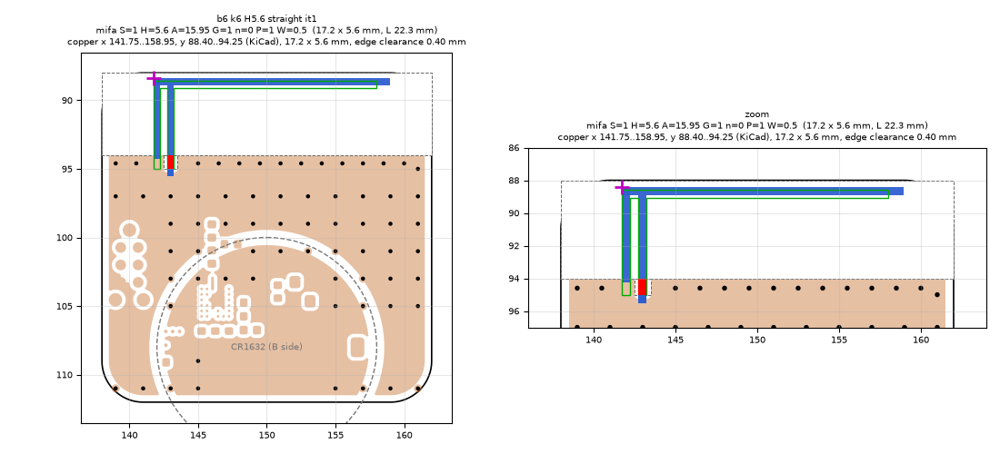
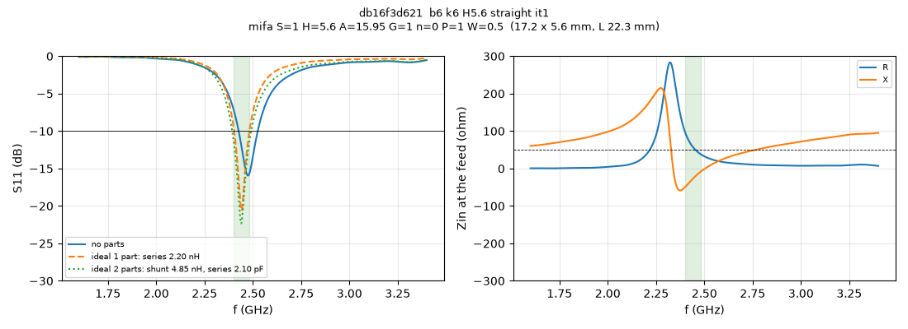

# db16f3d621  b6 k6 H5.6 straight it1

**Purpose:** Board copy b6 (feed at (143, 94), 24 x 6 keep-out, GND pours). b6 H5.4 straight it0 gave the deepest dip so far (-17.2 dB at 2.561 GHz, -10 dB band 110 MHz vs 75 MHz for the 5 mm keep-out b4). Variant: arm at the 6 mm keep-out limit (5.6 mm, 0.4 mm board edge clearance), length tuned so the S11 minimum sits at 2.465 GHz.

## Antenna

`mifa S=1 H=5.6 A=15.95 G=1 n=0 P=1 W=0.5  (17.2 x 5.6 mm, L 22.3 mm)`

| parameter | value |
|---|---|
| W | 0.5 |
| Wf | 0.5 |
| Ws | 0.5 |
| S | 1 |
| H | 5.6 |
| A | 15.95 |
| G | 1 |
| n | 0 |
| P | 1 |
| Nd | 1 |
| Nw | 1 |
| K | 1 |
| site | {"x": -7.0, "y": 6.0, "rot": 0, "mirror": false} |

Copper 17.20 x 5.60 mm above the ground edge (96.3 mm2), centre-line length 22.3 mm.
KiCad position of the copper: x 141.75..158.95, y 88.40..94.25, edge clearance 0.40 mm.

## Impedance at the feed (port across the notch)

| | |
|---|---|
| S11 minimum | -15.9 dB at 2.475 GHz |
| Z at 2.44 GHz | 57.8 -27.3j ohm |
| -10 dB band | 2.427-2.525 GHz |
| worst BLE S11, no parts | -7.1 dB |
| worst BLE S11, best ideal 1 part | -9.4 dB (series 2.20 nH) |
| worst BLE S11, best ideal 2 parts | -11.2 dB (shunt 4.85 nH, series 2.10 pF) |

Ideal lossless parts right at the feed, listed from the antenna toward the chip (shunt first = shunt on the antenna side). Real parts on pads with a trace and Q 30-50 give less (BSN: -15.3 dB ideal became -10.9 dB).

## Efficiency (raw own far-field transform, about +-10 %)

| f (GHz) | radiation eff. | total eff. (no match) | Dmax (dBi) |
|---|---|---|---|
| 2.40 | 107 % | 86 % | 1.8 |
| 2.44 | 108 % | 101 % | 1.8 |
| 2.48 | 109 % | 106 % | 1.9 |

## Run

board `build/b6/board.json`, battery True, mask none, model m3, 2201682 cells, 3034 s.
