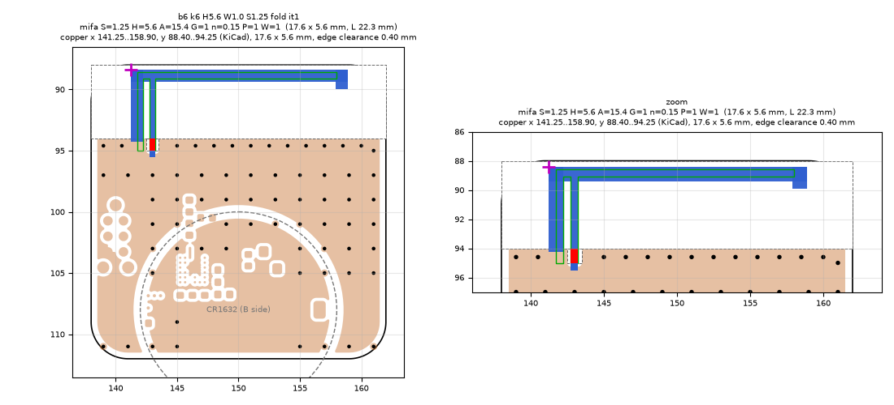
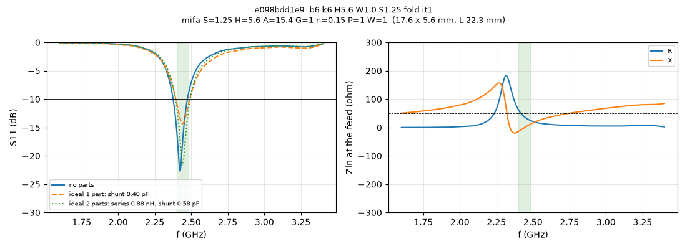

# e098bdd1e9  b6 k6 H5.6 W1.0 S1.25 fold it1

**Purpose:** Board copy b6 (feed at (143, 94), 24 x 6 keep-out, GND pours). On b4 (5 mm keep-out) 1 mm traces widened the -10 dB band from 68 to 83 MHz (-17.6 dB dip). Variant: the same 1 mm traces in the 6 mm keep-out, arm 5.6 mm high, short fold at the end (the corner limits a straight arm to A 15.95), fold length n tuned so the S11 minimum sits at 2.465 GHz.

## Antenna

`mifa S=1.25 H=5.6 A=15.4 G=1 n=0.15 P=1 W=1  (17.6 x 5.6 mm, L 22.3 mm)`

| parameter | value |
|---|---|
| W | 1 |
| Wf | 0.5 |
| Ws | 1 |
| S | 1.25 |
| H | 5.6 |
| A | 15.4 |
| G | 1 |
| n | 0.15 |
| P | 1 |
| Nd | 1 |
| Nw | 1 |
| K | 1 |
| site | {"x": -7.0, "y": 6.0, "rot": 0, "mirror": false} |

Copper 17.65 x 5.60 mm above the ground edge (98.8 mm2), centre-line length 22.3 mm.
KiCad position of the copper: x 141.25..158.90, y 88.40..94.25, edge clearance 0.40 mm.

## Impedance at the feed (port across the notch)

| | |
|---|---|
| S11 minimum | -22.7 dB at 2.423 GHz |
| Z at 2.44 GHz | 38.4 -0.7j ohm |
| -10 dB band | 2.376-2.473 GHz |
| worst BLE S11, no parts | -8.7 dB |
| worst BLE S11, best ideal 1 part | -10.6 dB (shunt 0.40 pF) |
| worst BLE S11, best ideal 2 parts | -11.4 dB (series 0.88 nH, shunt 0.58 pF) |

Ideal lossless parts right at the feed, listed from the antenna toward the chip (shunt first = shunt on the antenna side). Real parts on pads with a trace and Q 30-50 give less (BSN: -15.3 dB ideal became -10.9 dB).

## Efficiency (raw own far-field transform, about +-10 %)

| f (GHz) | radiation eff. | total eff. (no match) | Dmax (dBi) |
|---|---|---|---|
| 2.40 | 108 % | 105 % | 1.8 |
| 2.44 | 110 % | 108 % | 1.8 |
| 2.48 | 113 % | 99 % | 1.9 |

## Run

board `build/b6/board.json`, battery True, mask none, model m3, 2196876 cells, 4710 s.
