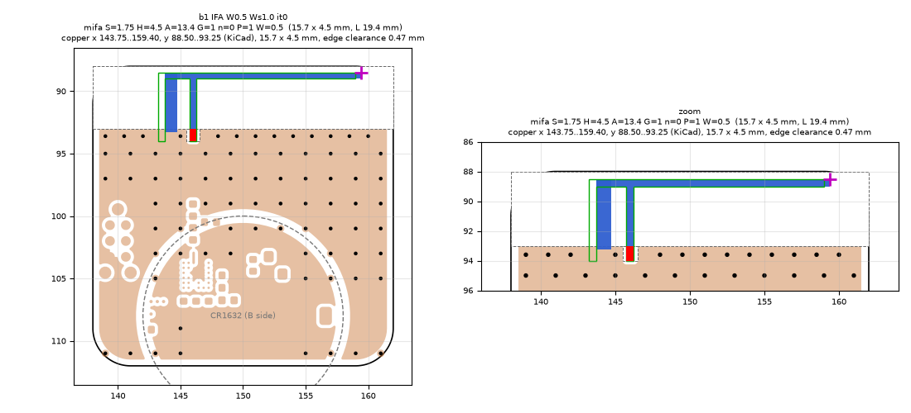
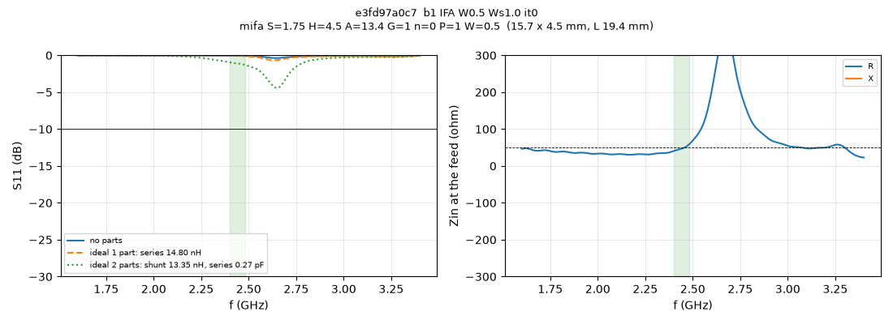

# e3fd97a0c7  b1 IFA W0.5 Ws1.0 it0

**Purpose:** Real board copy b1 (sim/boards/b1: AirTag.kicad_pcb of 2026-11-14 01:21, AE1 = generic MIFA_2G4 with the 24 x 5 mm keep-out at (146.0, 93.0) straight above L1, GND pours on both layers with a via fence, feed trace not routed, port across the notch). Can the antenna reach 50 ohm without parts? Tuned: arm length A to 2.465 GHz and S towards Rmax 50 ohm. Variant: 1 mm short leg only (lower stub inductance).

## Antenna

`mifa S=1.75 H=4.5 A=13.4 G=1 n=0 P=1 W=0.5  (15.7 x 4.5 mm, L 19.4 mm)`

| parameter | value |
|---|---|
| W | 0.5 |
| Wf | 0.5 |
| Ws | 1 |
| S | 1.75 |
| H | 4.5 |
| A | 13.4 |
| G | 1 |
| n | 0 |
| P | 1 |
| Nd | 1 |
| Nw | 1 |
| K | 1 |
| site | {"x": -4.0, "y": 7.0, "rot": 0, "mirror": false} |

Copper 15.65 x 4.50 mm above the ground edge (70.4 mm2), centre-line length 19.4 mm.
KiCad position of the copper: x 143.75..159.40, y 88.50..93.25, edge clearance 0.47 mm.

## Impedance at the feed (port across the notch)

| | |
|---|---|
| S11 minimum | -0.4 dB at 2.643 GHz |
| Z at 2.44 GHz | 46.5 -927.2j ohm |
| -10 dB band | - |
| worst BLE S11, no parts | -0.0 dB |
| worst BLE S11, best ideal 1 part | -0.1 dB (series 14.80 nH) |
| worst BLE S11, best ideal 2 parts | -1.0 dB (shunt 13.35 nH, series 0.27 pF) |

Ideal lossless parts right at the feed, listed from the antenna toward the chip (shunt first = shunt on the antenna side). Real parts on pads with a trace and Q 30-50 give less (BSN: -15.3 dB ideal became -10.9 dB).

## Efficiency (raw own far-field transform, about +-10 %)

| f (GHz) | radiation eff. | total eff. (no match) | Dmax (dBi) |
|---|---|---|---|
| 2.40 | 38 % | 0 % | 1.9 |
| 2.44 | 47 % | 1 % | 1.9 |
| 2.48 | 61 % | 1 % | 1.9 |

## Run

board `build/b1/board.json`, battery True, mask none, model m2, 2128880 cells, 10332 s.
