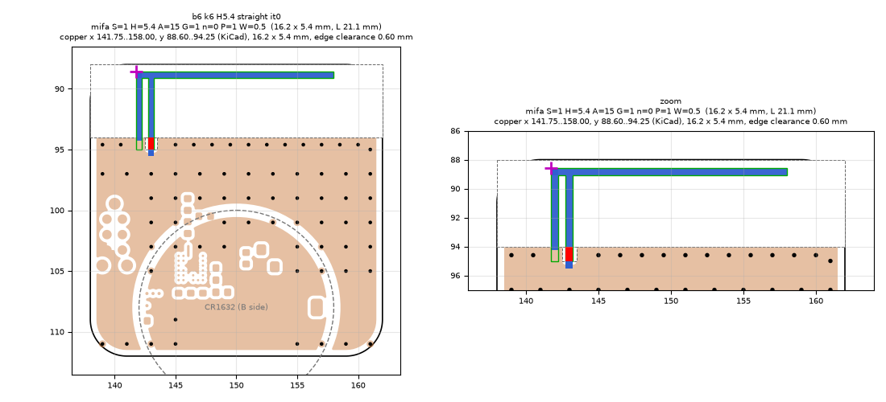
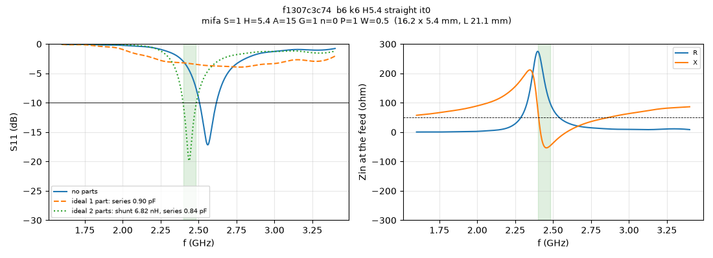

# f1307c3c74  b6 k6 H5.4 straight it0

**Purpose:** Keep-out height experiment, feed at (143, 94) like b4, the keep-out top stays at the board edge (KiCad y 88). Board copy b6 (sim/boards/b6: AirTag.kicad_pcb of 2026-11-14 01:21 with GND pours and a via fence, AE1 = MIFA_f143k6: 24 x 6 mm keep-out). b4 (24 x 5) straight IFA it0 gave S11 -14.4 dB at 2.551 GHz with Z 40-14j at the minimum and a 90 MHz -10 dB band. Does a 6 mm (taller) keep-out widen (or narrow) the matched band? S at its minimum, length tuned so the S11 minimum sits at 2.465 GHz. Variant: straight IFA, arm 5.4 mm high (max straight A 17.0).

## Antenna

`mifa S=1 H=5.4 A=15 G=1 n=0 P=1 W=0.5  (16.2 x 5.4 mm, L 21.1 mm)`

| parameter | value |
|---|---|
| W | 0.5 |
| Wf | 0.5 |
| Ws | 0.5 |
| S | 1 |
| H | 5.4 |
| A | 15 |
| G | 1 |
| n | 0 |
| P | 1 |
| Nd | 1 |
| Nw | 1 |
| K | 1 |
| site | {"x": -7.0, "y": 6.0, "rot": 0, "mirror": false} |

Copper 16.25 x 5.40 mm above the ground edge (87.8 mm2), centre-line length 21.1 mm.
KiCad position of the copper: x 141.75..158.00, y 88.60..94.25, edge clearance 0.60 mm.

## Impedance at the feed (port across the notch)

| | |
|---|---|
| S11 minimum | -17.2 dB at 2.561 GHz |
| Z at 2.44 GHz | 182.2 -47.2j ohm |
| -10 dB band | 2.507-2.617 GHz |
| worst BLE S11, no parts | -3.0 dB |
| worst BLE S11, best ideal 1 part | -3.2 dB (series 0.90 pF) |
| worst BLE S11, best ideal 2 parts | -10.4 dB (shunt 6.82 nH, series 0.84 pF) |

Ideal lossless parts right at the feed, listed from the antenna toward the chip (shunt first = shunt on the antenna side). Real parts on pads with a trace and Q 30-50 give less (BSN: -15.3 dB ideal became -10.9 dB).

## Efficiency (raw own far-field transform, about +-10 %)

| f (GHz) | radiation eff. | total eff. (no match) | Dmax (dBi) |
|---|---|---|---|
| 2.40 | 107 % | 53 % | 1.8 |
| 2.44 | 108 % | 70 % | 1.8 |
| 2.48 | 108 % | 88 % | 1.9 |

## Run

board `build/b6/board.json`, battery True, mask none, model m3, 2189845 cells, 6714 s.
