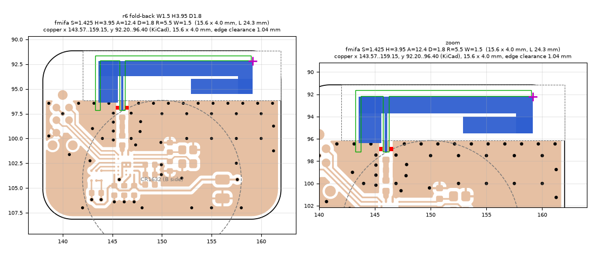
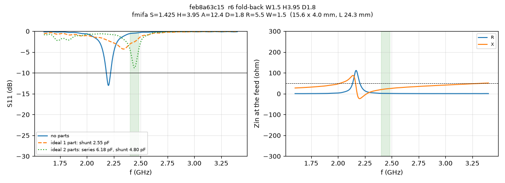

# feb8a63c15  r6 fold-back W1.5 H3.95 D1.8

**Purpose:** Board r6 = AirTag.kicad_pcb of 2026-11-14 23:46: L1 moved 0.75 mm up against the AE1 feed pad (feed trace in the pour almost gone), 7 vias moved. Matching parts are allowed now (user 2026-11-14): the antenna is scored by its Q and by match_tee.py (L2-C1-L1 T network, real 0402 parts, power into the antenna, >= 20 dB harmonic rejection). Base a63681b23e (S1.425 Ws2 Wf0.25 R5.5, Q 32, best T: worst channel -1.25 dB). Variant: 1.5 mm traces (H lowered to 3.95 so the arm stays in the 5 mm keep-out). Lower Q?

## Antenna

`fmifa S=1.425 H=3.95 A=12.4 D=1.8 R=5.5 W=1.5  (15.6 x 4.0 mm, L 24.3 mm)`

| parameter | value |
|---|---|
| W | 1.5 |
| Wf | 0.25 |
| Ws | 2 |
| S | 1.425 |
| H | 3.95 |
| A | 12.4 |
| D | 1.8 |
| R | 5.5 |
| Nd | 1 |
| Nw | 0 |
| K | 1 |
| site | {"x": -4.0, "y": 3.55, "rot": 0, "mirror": false} |

Copper 15.57 x 3.95 mm above the ground edge (61.5 mm2), centre-line length 24.3 mm.
KiCad position of the copper: x 143.57..159.15, y 92.20..96.40, edge clearance 1.04 mm.

## Impedance at the feed (port across the notch)

| | |
|---|---|
| S11 minimum | -13.0 dB at 2.201 GHz |
| Z at 2.44 GHz | 1.6 +22.9j ohm |
| -10 dB band | 2.182-2.220 GHz |
| worst BLE S11, no parts | -0.3 dB |
| worst BLE S11, best ideal 1 part | -1.7 dB (shunt 2.55 pF) |
| worst BLE S11, best ideal 2 parts | -4.3 dB (series 6.18 pF, shunt 4.80 pF) |

Ideal lossless parts right at the feed, listed from the antenna toward the chip (shunt first = shunt on the antenna side). Real parts on pads with a trace and Q 30-50 give less (BSN: -15.3 dB ideal became -10.9 dB).

## Efficiency (raw own far-field transform, about +-10 %)

| f (GHz) | radiation eff. | total eff. (no match) | Dmax (dBi) |
|---|---|---|---|
| 2.40 | 62 % | 7 % | 1.7 |
| 2.44 | 55 % | 6 % | 1.7 |
| 2.48 | 60 % | 5 % | 1.7 |

## Run

board `build/r6/board.json`, battery True, mask none, model m3, 1953372 cells, 2495 s.
